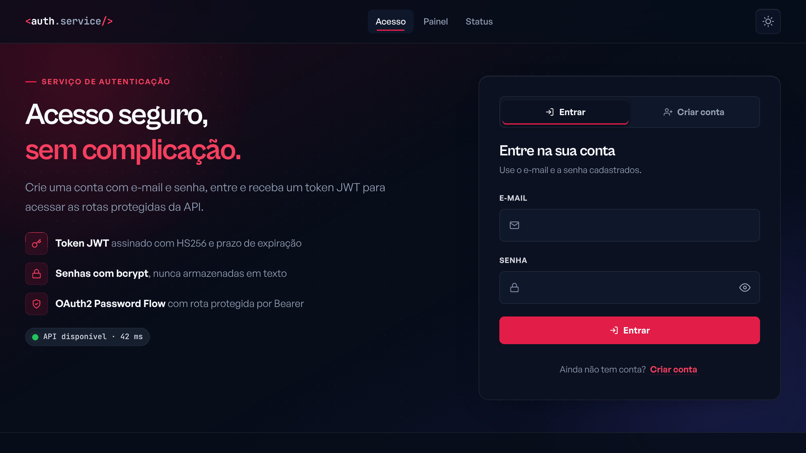
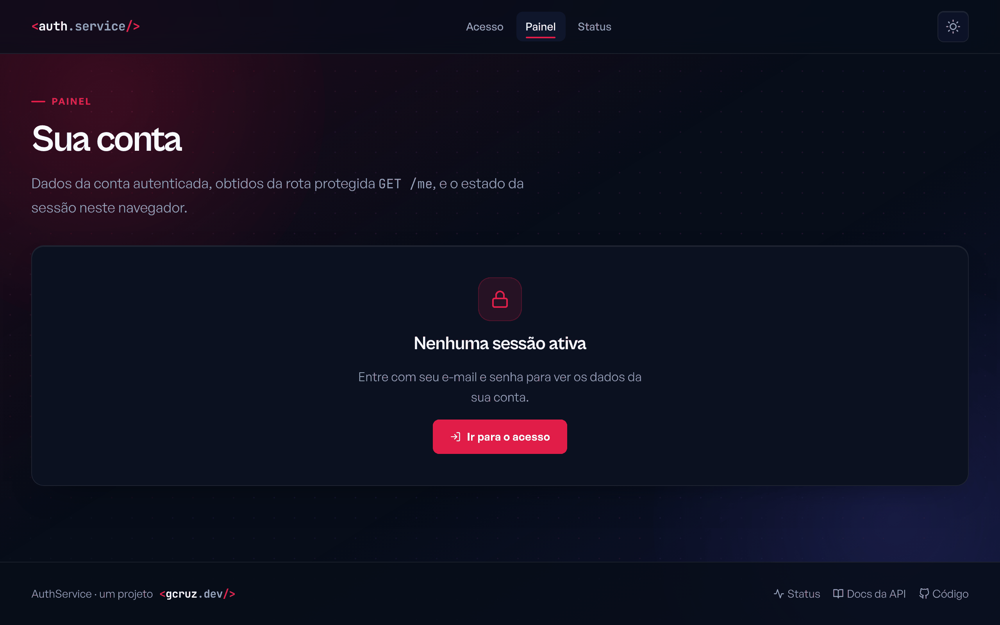

<h1 align="center">🔐 AuthService</h1>

<p align="center">
  Serviço de autenticação fullstack: API REST em <strong>FastAPI</strong> com <strong>JWT</strong> e <strong>bcrypt</strong>,<br/>
  e um frontend próprio servido pelo mesmo processo, em um único container Docker.
</p>

<div align="center">

  [](https://authservice-mbul.onrender.com/docs)
  [](./read-model/LICENSE)
  [](./Dockerfile)
  [](https://fastapi.tiangolo.com)
  [](https://python.org)

</div>

---

<div align="center">
  
</div>

---

## 🌐 Demonstração

<div align="center">

| | |
|---|---|
| 🔗 **Aplicação** | [authservice-mbul.onrender.com](https://authservice-mbul.onrender.com) |
| 📖 **API Docs (Swagger)** | [authservice-mbul.onrender.com/docs](https://authservice-mbul.onrender.com/docs) |
| 📡 **Health check** | [authservice-mbul.onrender.com/health](https://authservice-mbul.onrender.com/health) |
| ⚠️ **Aviso** | Hospedado no plano gratuito do Render: a primeira requisição pode levar até **50 segundos** (cold start), e os usuários cadastrados somem a cada reinício (armazenamento em memória). |

</div>

---

## 📌 O que é

O **AuthService** é um serviço de autenticação de escopo enxuto, pensado para estudo e portfólio. O backend registra usuários, autentica credenciais, emite tokens **JWT** e protege rotas com o esquema **Bearer**. O frontend, servido pelo próprio FastAPI como arquivos estáticos, oferece:

- **Acesso** — entrar e criar conta;
- **Painel** — dados da conta autenticada e estado da sessão;
- **Status** — verificações reais dos endpoints, feitas a partir do navegador.

A identidade visual é a mesma do portfólio do autor, [gcruz.dev.br](https://gcruz.dev.br): crimson e índigo sobre neutros slate, tipografia Cabinet Grotesk, General Sans e JetBrains Mono, e o logo tipográfico `<auth.service/>` na mesma construção de `<gcruz.dev/>`.

---

## ✨ Funcionalidades

**API**
- Cadastro com validação de e-mail e de senha (mínimo de 8 caracteres, ao menos uma letra e um número).
- Login pelo fluxo OAuth2 Password (`application/x-www-form-urlencoded`), com emissão de JWT assinado em HS256.
- Rota protegida `GET /me` com `Authorization: Bearer <token>`.
- `GET /health` para verificação de disponibilidade.
- Documentação automática do FastAPI em `/docs` (Swagger UI), `/redoc` e `/openapi.json`.

**Frontend**
- Abas acessíveis **Entrar / Criar conta** (teclado: setas, Home, End; link direto para `#cadastro`).
- Validação no cliente que espelha as regras do servidor, com mensagens por campo, checklist dos requisitos da senha e medidor de força apenas indicativo.
- Mostrar/ocultar senha, botões com estado de carregamento e bloqueio de envio duplicado.
- Painel com e-mail e ID vindos de `/me`, expiração e algoritmo lidos do próprio token, contagem regressiva e aviso de expiração próxima.
- Tratamento de sessão: um 401 ou o fim do prazo do token removem os dados locais e levam a uma tela de "sessão expirada/inválida".
- Token JWT **oculto por padrão** no painel, com ações explícitas de mostrar e copiar.
- Página de status com cinco estados distintos (disponível, indisponível, falha de autenticação, falha de comunicação, não verificado), tempo de resposta medido e histórico da visita.
- Temas escuro e claro: respeita a preferência do sistema, guarda a escolha e não pisca ao carregar.
- Layout responsivo (360 px a desktop), navegação por teclado, foco visível, `prefers-reduced-motion` e mensagens anunciadas a leitores de tela.

---

## 🖼️ Telas

<div align="center">
  
  <br/><sub>Acesso — entrar</sub>
</div>

<br/>

| Login preenchido | Criar conta |
|---|---|
|  |  |

| Cadastro (tema claro) | Painel |
|---|---|
|  |  |

| Sem sessão | Status da API |
|---|---|
|  |  |

---

## 🛠️ Tecnologias

**Backend** — FastAPI · Uvicorn · Pydantic v2 (com `email-validator`) · pydantic-settings · python-jose (JWT) · bcrypt 4.0.1 · python-multipart · python-dotenv. Apenas o `bcrypt` tem versão fixada em `requirements.txt`.

**Frontend** — HTML, CSS e JavaScript nativos, sem framework e sem etapa de build. Módulos ES (`type="module"`), ícones SVG próprios em sprite (`frontend/public/icons.svg`), fontes Cabinet Grotesk e General Sans (Fontshare) e JetBrains Mono (Google Fonts).

**Infraestrutura** — Docker (`python:3.11-slim`) e Docker Compose, com healthcheck em `/health`. Deploy no Render. Análise de segurança com CodeQL no GitHub Actions.

---

## 🧱 Arquitetura

```
Navegador ── HTML/CSS/JS estáticos ──┐
   │                                 │  servidos pelo mesmo processo
   └── fetch (mesma origem) ──► FastAPI (backend/main.py)
                                   ├── api/auth_routes.py         rotas HTTP
                                   ├── services/auth_service.py   regras de negócio
                                   ├── repositories/user_repository.py   dados em memória
                                   ├── models/user.py · schemas/user_schemas.py
                                   ├── dependencies/dependencies.py      get_current_user
                                   └── core/ (config, security, logger)
```

As rotas da API são registradas antes de o diretório `frontend/` ser montado na raiz, então `/health`, `/register`, `/token`, `/me` e `/docs` têm prioridade sobre os arquivos estáticos.

Detalhes em [read-model/MODEL.md](./read-model/MODEL.md) (modelo, regras e fluxos) e [read-model/STRUCTURE.md](./read-model/STRUCTURE.md) (estrutura e setup).

---

## 🗂️ Estrutura

```
AuthService/
├── backend/                 API FastAPI (camadas: api → services → repositories → models)
├── frontend/
│   ├── index.html           acesso (entrar / criar conta)
│   ├── home.html            painel da conta
│   ├── status.html          status da API
│   ├── css/                 tokens, base, layout, components + um arquivo por página
│   ├── js/
│   │   ├── theme-init.js    aplica o tema antes da pintura
│   │   ├── core/            api, session, dom, theme, nav (compartilhados)
│   │   └── pages/           auth, dashboard, status (um por página)
│   └── public/              favicon.svg e sprite de ícones icons.svg
├── read-model/              MODEL.md, STRUCTURE.md, CONTRIBUTING.md, LICENSE, img/
├── .github/workflows/       codeql.yml
├── Dockerfile · docker-compose.yml · requirements.txt · .env.example
└── README.md
```

Árvore completa e responsabilidades de cada arquivo em [read-model/STRUCTURE.md](./read-model/STRUCTURE.md).

---

## ⚙️ Configuração

As variáveis são lidas de um arquivo `.env` na raiz (ou do ambiente) por `backend/core/config.py`.

| Variável | Descrição | Padrão no código | Valor no `.env.example` |
|---|---|---|---|
| `SECRET_KEY` | Chave que assina os tokens JWT | — (obrigatória: sem ela a aplicação não inicia) | uma chave de exemplo |
| `ALGORITHM` | Algoritmo de assinatura | `HS256` | `HS256` |
| `ACCESS_TOKEN_EXPIRE_MINUTES` | Validade do token, em minutos | `30` | `60` |

Ou seja: quem copia o `.env.example` sem editar tem tokens de **60 minutos**; sem a variável, valem **30**. O painel não presume nenhum dos dois: ele lê a expiração real (`exp`) de cada token.

> ⚠️ A `SECRET_KEY` do `.env.example` é pública (está no repositório). **Gere uma nova** antes de qualquer uso real; com a chave de exemplo, qualquer pessoa consegue assinar tokens válidos.

```bash
python -c "import secrets; print(secrets.token_hex(32))"
```

---

## 🚀 Como rodar

### Com Docker (recomendado)

Requisitos: Docker 24+ e Docker Compose v2.

```bash
git clone https://github.com/https-shini/AuthService.git
cd AuthService
cp .env.example .env        # edite a SECRET_KEY
docker compose up --build -d
```

| Ação | Comando |
|---|---|
| Ver logs | `docker logs auth-service-v2 -f` |
| Estado e healthcheck | `docker ps` |
| Parar | `docker compose down` |

O `docker-compose.yml` exige o arquivo `.env` (`env_file`).

### Sem Docker

Requisitos: Python 3.11+.

```bash
git clone https://github.com/https-shini/AuthService.git
cd AuthService
python -m venv venv
source venv/bin/activate     # Windows: venv\Scripts\activate
pip install -r requirements.txt
cp .env.example .env         # edite a SECRET_KEY
uvicorn backend.main:app --host 0.0.0.0 --port 8000 --reload
```

Depois de subir, por qualquer um dos caminhos:

```
Frontend:   http://localhost:8000
Swagger:    http://localhost:8000/docs
Health:     http://localhost:8000/health
```

---

## 📡 Endpoints

| Método | Rota | Entrada | Sucesso | Erros |
|---|---|---|---|---|
| `GET` | `/health` | — | `200` `{ "status": "ok", "message": "…" }` | — |
| `POST` | `/register` | JSON `{ "email", "password" }` | `200` `{ "id", "email" }` | `400` e-mail já registrado · `422` validação |
| `POST` | `/token` | form `username` (e-mail), `password` | `200` `{ "access_token", "token_type": "bearer" }` | `401` credenciais incorretas · `422` campo ausente |
| `GET` | `/me` | header `Authorization: Bearer <token>` | `200` `{ "id", "email" }` | `401` token ausente, inválido ou expirado |

Os erros seguem o formato padrão do FastAPI: `{ "detail": "mensagem" }` ou, em `422`, `{ "detail": [ { "loc", "msg", "type" } ] }`. O cadastro responde **200** (e não 201).

### Exemplos com cURL

```bash
curl -X POST http://localhost:8000/register \
  -H "Content-Type: application/json" \
  -d '{"email": "usuario@email.com", "password": "Senha123"}'
```

```bash
curl -X POST http://localhost:8000/token \
  -d "username=usuario@email.com&password=Senha123"
```

```bash
curl http://localhost:8000/me \
  -H "Authorization: Bearer SEU_TOKEN_AQUI"
```

---

## 🔑 Autenticação

1. `POST /register` valida o e-mail (`EmailStr`) e a senha, gera o hash com **bcrypt** e guarda o usuário em memória.
2. `POST /token` confere e-mail e hash e devolve um JWT com `sub` (o e-mail) e `exp` (agora + `ACCESS_TOKEN_EXPIRE_MINUTES`), assinado com `SECRET_KEY`.
3. O frontend guarda **somente o token** no `sessionStorage` da aba (some ao fechá-la), junto com o horário do login. A senha nunca é armazenada nem exibida.
4. Rotas protegidas recebem `Authorization: Bearer <token>`. `get_current_user` decodifica o token e busca o usuário pelo e-mail; qualquer falha gera `401`.
5. Não há refresh token nem revogação: o token vale até expirar. "Encerrar sessão" apaga os dados locais.

Autorização: existe apenas a distinção entre autenticado e não autenticado. Não há papéis ou permissões.

---

## 🛡️ Segurança no frontend

- Nenhuma senha em `sessionStorage`, `localStorage`, cookies ou logs; o campo é esvaziado após o login. Chaves antigas (`auth_pass`, `auth_email`) gravadas por versões anteriores são apagadas automaticamente.
- Nenhum dado externo entra via `innerHTML`: o DOM é montado com `createElement`/`textContent`.
- **Content Security Policy** via `<meta>`: scripts só da própria origem (nenhum script inline), estilos da origem, Fontshare e Google Fonts, conexões só com a própria API.
- Token oculto por padrão no painel, nunca em URLs.

---

## ⚠️ Limitações conhecidas

- **Persistência em memória**: todos os usuários somem quando o processo reinicia.
- **Sem rate limiting** em `/token` (exposto a força bruta).
- **E-mail sensível a maiúsculas** na parte local: `Usuario@x.com` e `usuario@x.com` são contas diferentes, e entrar com a variação errada retorna 401.
- **Token no `sessionStorage`**: acessível a JavaScript da página. A CSP reduz o risco de XSS, mas um cookie `HttpOnly` exigiria mudança no backend.
- **Sem refresh token, revogação ou logout no servidor.**
- `requirements.txt` sem versões fixadas (exceto `bcrypt`).

---

## 🗺️ Pendências / Roadmap

Itens planejados — **nenhum deles está implementado**. Todos exigem mudanças no backend.

| Prioridade | Item | Descrição |
|---|---|---|
| Alta | Rate limiting | Limitar tentativas em `/token` (por exemplo, 5 por IP/minuto com bloqueio progressivo). |
| Alta | Refresh token | Renovar o acesso sem pedir credenciais ao expirar (`POST /refresh`). |
| Alta | Campo nome | Adicionar `name` ao modelo `User` e ao schema `UserCreate`. O frontend não coleta nome até lá. |
| Média | Banco persistente | Migrar do armazenamento em memória para PostgreSQL + SQLAlchemy + Alembic (ou SQLite como passo intermediário). |
| Média | MFA / TOTP | Segundo fator com aplicativo autenticador (`POST /mfa/enable`, `POST /mfa/verify`). |
| Média | RBAC | Papéis (admin, user, guest) como claim no JWT e autorização por rota. |
| Média | Normalizar e-mail | Comparar e-mails sem diferenciar maiúsculas no cadastro e no login. |
| Média | Cookie `HttpOnly` | Entregar o token em cookie `HttpOnly; Secure; SameSite`, tirando-o do alcance de JavaScript. |
| Média | Headers de segurança | CSP, `X-Content-Type-Options`, `Referrer-Policy` etc. enviados pelo servidor (hoje a CSP vem de `<meta>`). |
| Baixa | `201 Created` | Fazer `/register` responder 201, como é convenção para criação. |
| Baixa | Recuperação de senha | Reset por e-mail com token temporário de uso único (requer SMTP). |
| Baixa | Logs estruturados | Logs em JSON com níveis e correlation IDs. |
| Baixa | Segredos fora do `.env` | `SECRET_KEY` em gerenciador de segredos (Vault, AWS SSM, Docker Secrets) em produção. |

---

## 🤝 Como contribuir

O passo a passo está em [read-model/CONTRIBUTING.md](./read-model/CONTRIBUTING.md) (PT-BR e EN-US). Commits seguem Conventional Commits:

```bash
git checkout -b minha-feature
git commit -m "feat: minha nova feature"
git push origin minha-feature
```

---

## 📚 Documentação adicional

| Arquivo | Conteúdo |
|---|---|
| [read-model/MODEL.md](./read-model/MODEL.md) | Entidades, regras de negócio, fluxos e decisões arquiteturais |
| [read-model/STRUCTURE.md](./read-model/STRUCTURE.md) | Estrutura de diretórios, responsabilidades e setup |
| [read-model/CONTRIBUTING.md](./read-model/CONTRIBUTING.md) | Guia de contribuição |

---

## 📄 Licença

Distribuído sob a licença **MIT**. Veja [read-model/LICENSE](./read-model/LICENSE).

---

<div align="center">

Um projeto [`<gcruz.dev/>`](https://gcruz.dev.br) — autenticação simples, segura e com a mesma identidade do portfólio.

</div>


