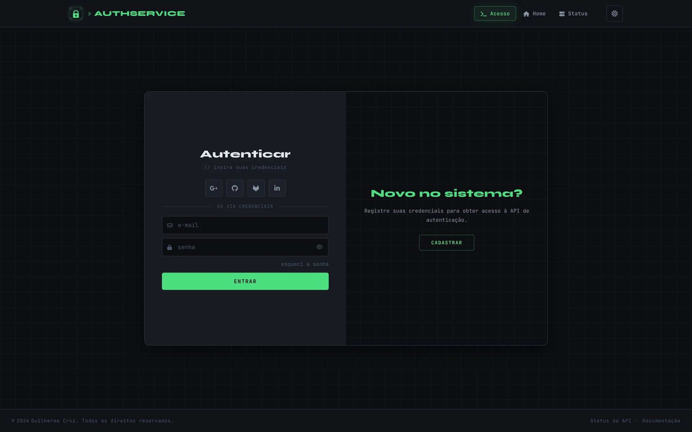
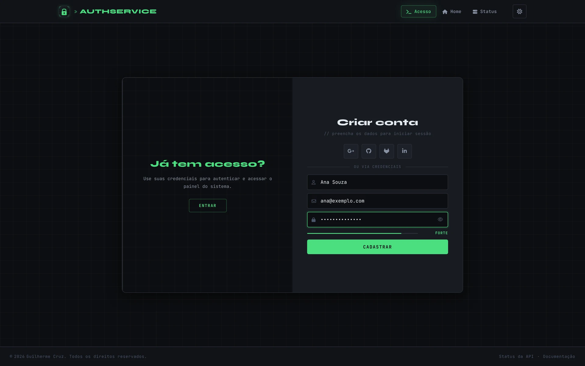
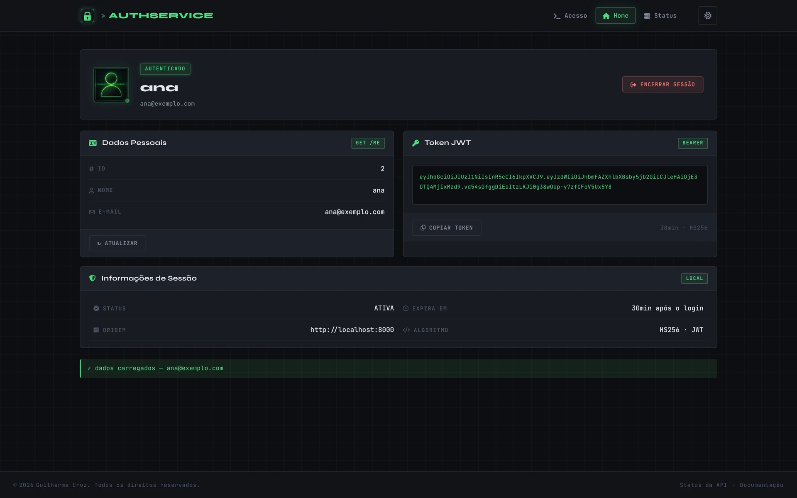
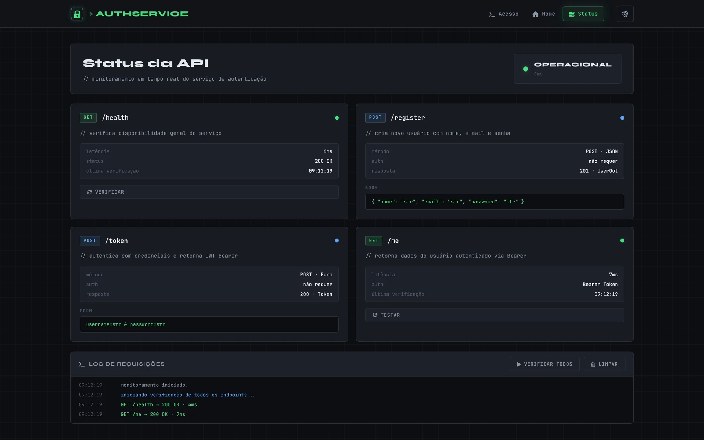
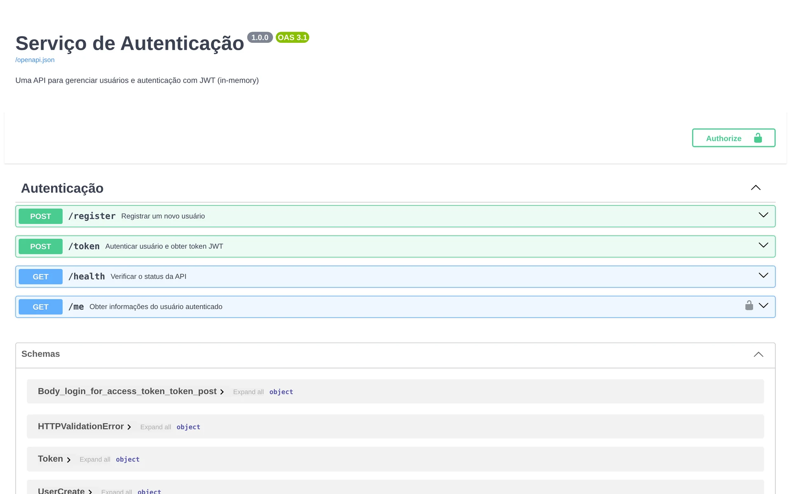
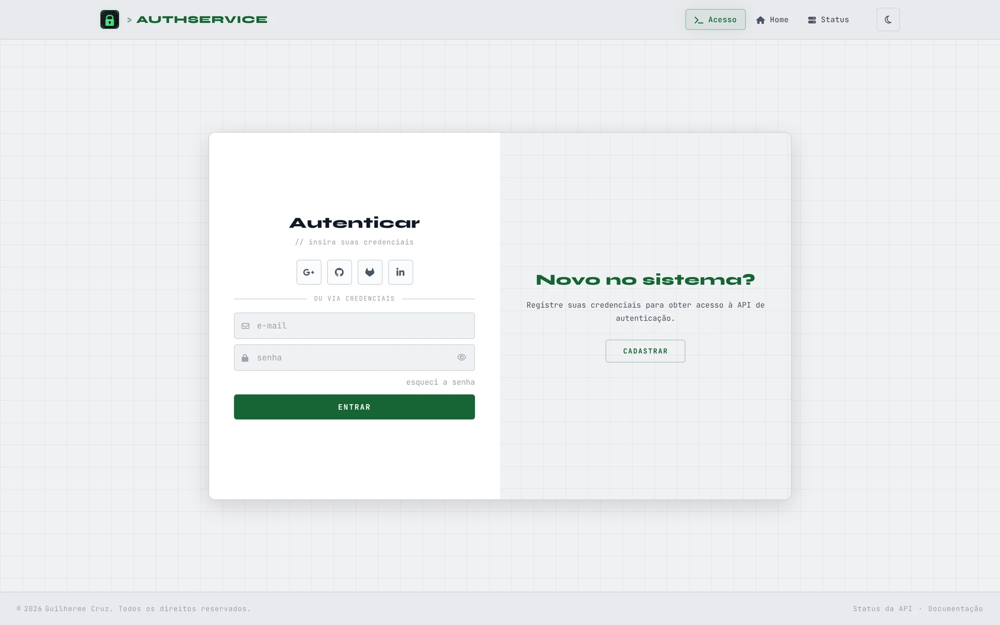
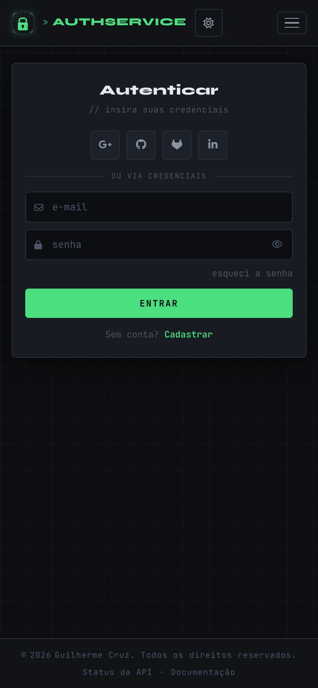

<h1 align="center">Auth Service</h1>

<p align="center">
  Serviço de autenticação full stack: <strong>API REST em FastAPI com JWT</strong> e frontend em JavaScript puro,<br>
  servidos juntos em um único container Docker.
</p>

<div align="center">

[](https://authservice.gcruz.dev.br)
[](https://authservice.gcruz.dev.br/docs)
[](Dockerfile)
[](LICENSE)

</div>


<p align="center">
  <a href="https://authservice.gcruz.dev.br"><strong>Acessar a aplicação</strong></a> ·
  <a href="https://authservice.gcruz.dev.br/docs">Documentação interativa (Swagger)</a> ·
  <a href="https://authservice.gcruz.dev.br/health">Health check</a>
</p>

> [!NOTE]
> A demonstração roda no plano gratuito do Render: a primeira requisição após inatividade pode levar cerca de 50 segundos. Os usuários ficam **em memória** e são apagados a cada reinício do serviço.

---

## Sumário

- [Sobre o projeto](#sobre-o-projeto)
- [Problema e proposta](#problema-e-proposta)
- [Funcionalidades](#funcionalidades)
- [Capturas de tela](#capturas-de-tela)
- [Tecnologias](#tecnologias)
- [Arquitetura](#arquitetura)
- [Pré-requisitos](#pré-requisitos)
- [Instalação](#instalação)
- [Variáveis de ambiente](#variáveis-de-ambiente)
- [Execução local](#execução-local)
- [Endpoints da API](#endpoints-da-api)
- [Exemplos de uso](#exemplos-de-uso)
- [Build e produção](#build-e-produção)
- [Limitações conhecidas](#limitações-conhecidas)
- [Documentação complementar](#documentação-complementar)
- [Licença](#licença)

## Sobre o projeto

O Auth Service é um serviço de autenticação que reúne uma API REST em FastAPI e uma interface web servida pelo próprio backend. A API registra usuários, autentica com e-mail e senha, emite tokens JWT assinados com HS256 e protege rotas com o esquema OAuth2 _Bearer_.

O frontend, em HTML, CSS e JavaScript puros, oferece cadastro e login com medidor de força de senha, um painel que consome a rota protegida `/me` e uma página de status que mede a latência de cada endpoint em tempo real.

## Problema e proposta

Toda aplicação com usuários precisa resolver cadastro, login e proteção de rotas antes de qualquer regra de negócio. O projeto implementa esse fluxo de forma isolada e didática, com a lógica dividida em camadas (rotas, serviço, repositório, segurança) para que cada responsabilidade possa ser estudada, testada ou substituída — por exemplo, trocando o repositório em memória por um banco de dados sem alterar as rotas.

## Funcionalidades

- **Cadastro de usuários** — validação de e-mail (Pydantic `EmailStr`) e de senha (mínimo de 8 caracteres, com ao menos uma letra e um número); e-mails duplicados são recusados.
- **Login com JWT** — `POST /token` no formato OAuth2 (_form data_) devolve um token HS256 com expiração configurável.
- **Rota protegida** — `GET /me` retorna os dados do usuário dono do token; sem token ou com token inválido, responde `401`.
- **Senhas com bcrypt** — o hash é gerado com _salt_ aleatório; a senha em texto puro nunca é armazenada.
- **Painel do usuário** — exibe os dados de `/me`, o token JWT com botão de cópia e as informações da sessão.
- **Monitor de status** — testa `/health`, `/register`, `/token` e `/me`, mostrando latência, código de resposta e um log em formato de terminal.
- Tema claro e escuro com preferência salva no navegador.
- Documentação interativa gerada pelo FastAPI em `/docs` (Swagger UI) e `/redoc`.
- Proteção contra _log injection_: quebras de linha são removidas antes de registrar e-mails e mensagens de erro.
- Redirecionamento 308 do endereço `*.onrender.com` para o domínio oficial, preservando método e corpo.

## Capturas de tela

|                                          Login                                           |                         Cadastro com medidor de força                         |
| :--------------------------------------------------------------------------------------: | :---------------------------------------------------------------------------: |
|                                               |        |
|                                  **Painel do usuário**                                   |                               **Status da API**                               |
|             |  |
|                                      **Swagger UI**                                      |                                **Tema claro**                                 |
|  |           |

<p align="center">
  
</p>

> Capturas da aplicação real, executada localmente, com uma conta de demonstração.

## Tecnologias

**Backend**

- **Python 3.11** — versão da imagem Docker (`python:3.11-slim`).
- **FastAPI** — rotas, injeção de dependências e documentação OpenAPI.
- **Uvicorn** — servidor ASGI.
- **Pydantic v2** — validação de entrada e saída (`EmailStr`, `field_validator`).
- **pydantic-settings** — configuração por variáveis de ambiente e `.env`.
- **python-jose** — emissão e validação de JWT.
- **bcrypt** — hash de senhas (versão fixada em 4.0.1).
- **python-multipart** — leitura do formulário OAuth2 em `/token`.

**Frontend**

- **HTML, CSS e JavaScript** — sem framework, organizados em tokens, componentes e páginas.
- **sessionStorage** — guarda o token durante a sessão da aba.

**Infraestrutura**

- **Docker** — imagem única com API e arquivos estáticos, com `HEALTHCHECK`.
- **Docker Compose** — execução local com `.env`.
- **Render** — hospedagem da demonstração.
- **CodeQL** — análise de segurança no GitHub Actions.

## Arquitetura

O backend segue uma divisão em camadas; o FastAPI injeta cada dependência na rota que a usa:

```text
Requisição HTTP
     │
     ▼
api/auth_routes.py ──► services/auth_service.py ──► repositories/user_repository.py
 (rotas e respostas)    (regras: duplicidade,        (armazenamento em memória:
                         verificação de senha)         dicionário id → User)
     │                         │
     ▼                         ▼
dependencies/          core/security.py
 get_current_user       (bcrypt e JWT)
 (OAuth2 Bearer → User)
```

O mesmo processo serve os arquivos de `frontend/` como estáticos na raiz (`/`), por isso o frontend chama a API pela própria origem, sem CORS.

<details>
<summary><strong>Estrutura de diretórios</strong></summary>

```text
AuthService/
├── backend/
│   ├── main.py                     app FastAPI, middleware de redirecionamento e estáticos
│   ├── api/auth_routes.py          /register, /token, /health, /me
│   ├── core/
│   │   ├── config.py               Settings (pydantic-settings)
│   │   ├── security.py             hash bcrypt e JWT
│   │   └── logger.py               configuração de logs
│   ├── dependencies/dependencies.py repositório compartilhado e get_current_user
│   ├── models/user.py              entidade User
│   ├── repositories/user_repository.py armazenamento em memória
│   ├── schemas/user_schemas.py     UserCreate, UserOut, Token
│   └── services/auth_service.py    regras de cadastro e autenticação
├── frontend/
│   ├── index.html                  login e cadastro
│   ├── home.html                   painel do usuário autenticado
│   ├── status.html                 monitor dos endpoints
│   ├── css/                        tokens, componentes e páginas
│   └── js/                         auth, home, status, tema, navegação e utilitários
├── docs/images/                    capturas de tela
├── read-model/                     documentação de modelo, estrutura e contribuição
├── Dockerfile
├── docker-compose.yml
└── requirements.txt
```

</details>

## Pré-requisitos

- **Docker** e **Docker Compose** (recomendado), ou
- **Python 3.11** e **pip** para executar sem container.

## Instalação

```bash
git clone https://github.com/https-shini/AuthService.git
```

```bash
cd AuthService
```

```bash
cp .env.example .env
```

Gere uma chave secreta e coloque-a em `SECRET_KEY` no `.env`:

```bash
openssl rand -hex 32
```

## Variáveis de ambiente

| Variável                      | Obrigatória | Descrição                                                          | Padrão                           |
| ----------------------------- | :---------: | ------------------------------------------------------------------ | -------------------------------- |
| `SECRET_KEY`                  |     Sim     | Chave usada para assinar os tokens JWT                             | —                                |
| `ALGORITHM`                   |     Não     | Algoritmo de assinatura                                            | `HS256`                          |
| `ACCESS_TOKEN_EXPIRE_MINUTES` |     Não     | Validade do token em minutos                                       | `30` (o `.env.example` usa `60`) |
| `PUBLIC_URL`                  |     Não     | Domínio oficial; com ele, o endereço do Render redireciona para cá | vazio                            |
| `RENDER_EXTERNAL_HOSTNAME`    |     Não     | Definida automaticamente pelo Render; usada no redirecionamento    | vazio                            |

Exemplo seguro de `.env`:

```dotenv
SECRET_KEY=cole-aqui-o-resultado-de-openssl-rand-hex-32
ALGORITHM=HS256
ACCESS_TOKEN_EXPIRE_MINUTES=60
PUBLIC_URL=
```

Nunca versione o `.env` (ele já está no `.gitignore`).

## Execução local

**Com Docker Compose (recomendado)**

```bash
docker compose up --build
```

**Sem Docker**

```bash
python3 -m venv .venv
```

```bash
source .venv/bin/activate
```

```bash
pip install -r requirements.txt
```

```bash
uvicorn backend.main:app --reload --port 8000
```

Em ambos os casos, acesse:

| Endereço                          | Conteúdo                         |
| --------------------------------- | -------------------------------- |
| http://localhost:8000             | Login e cadastro                 |
| http://localhost:8000/home.html   | Painel do usuário (após o login) |
| http://localhost:8000/status.html | Status da API                    |
| http://localhost:8000/docs        | Swagger UI                       |

## Endpoints da API

| Método | Rota        | Autenticação | Corpo                                     | Resposta de sucesso                                |
| ------ | ----------- | :----------: | ----------------------------------------- | -------------------------------------------------- |
| `POST` | `/register` |      —       | JSON `{ "email", "password" }`            | `200` `{ "id", "email" }`                          |
| `POST` | `/token`    |      —       | Form `username=<e-mail>&password=<senha>` | `200` `{ "access_token", "token_type": "bearer" }` |
| `GET`  | `/me`       |    Bearer    | —                                         | `200` `{ "id", "email" }`                          |
| `GET`  | `/health`   |      —       | —                                         | `200` `{ "status": "ok", "message": "..." }`       |

Respostas de erro:

| Situação                                     | Código                            |
| -------------------------------------------- | --------------------------------- |
| E-mail já cadastrado                         | `400` `Email já registrado`       |
| Senha fraca ou e-mail inválido               | `422` com o detalhe da validação  |
| Credenciais incorretas                       | `401` `Email ou senha incorretos` |
| Token ausente, inválido ou expirado em `/me` | `401`                             |

## Exemplos de uso

Cadastrar um usuário:

```bash
curl -X POST http://localhost:8000/register \
  -H "Content-Type: application/json" \
  -d '{"email": "ana@exemplo.com", "password": "SenhaForte2026"}'
```

Obter o token:

```bash
curl -X POST http://localhost:8000/token \
  -d "username=ana@exemplo.com&password=SenhaForte2026"
```

Consultar a rota protegida com o token recebido:

```bash
curl http://localhost:8000/me \
  -H "Authorization: Bearer <access_token>"
```

## Build e produção

A imagem é construída a partir do `Dockerfile`, que instala as dependências, copia `backend/` e `frontend/`, expõe a porta `8000` e define um `HEALTHCHECK` em `/health`:

```bash
docker build -t auth-service .
```

```bash
docker run -p 8000:8000 --env-file .env auth-service
```

Para publicar no Render ou serviço equivalente: crie um _Web Service_ a partir do `Dockerfile`, defina `SECRET_KEY` (e, se houver domínio próprio, `PUBLIC_URL`) nas variáveis do painel e use `/health` como health check.

## Limitações conhecidas

- **Armazenamento em memória**: os usuários são perdidos a cada reinício; não há banco de dados.
- **Sem testes automatizados** do backend; a CI executa apenas a análise do CodeQL.
- Sem _refresh token_, revogação de tokens, recuperação de senha ou limite de tentativas de login.
- Na interface, os botões de login social (Google, GitHub, GitLab, LinkedIn) e o link "esqueci a senha" são apenas visuais.
- O formulário de cadastro coleta o nome, mas a API aceita apenas e-mail e senha; o painel exibe a parte do e-mail antes do `@`.
- O painel mostra a expiração fixa de "30min", mesmo que `ACCESS_TOKEN_EXPIRE_MINUTES` tenha outro valor.
- As dependências em `requirements.txt` não têm versão fixada (exceto `bcrypt`).

## Documentação complementar

- [Modelo de dados e fluxos](read-model/MODEL.md)
- [Estrutura e setup do projeto](read-model/STRUCTURE.md)
- [Como contribuir](read-model/CONTRIBUTING.md)

## Licença

Distribuído sob a licença MIT. Consulte o arquivo [LICENSE](LICENSE).

Desenvolvido por [Guilherme Cruz](https://gcruz.dev.br).
