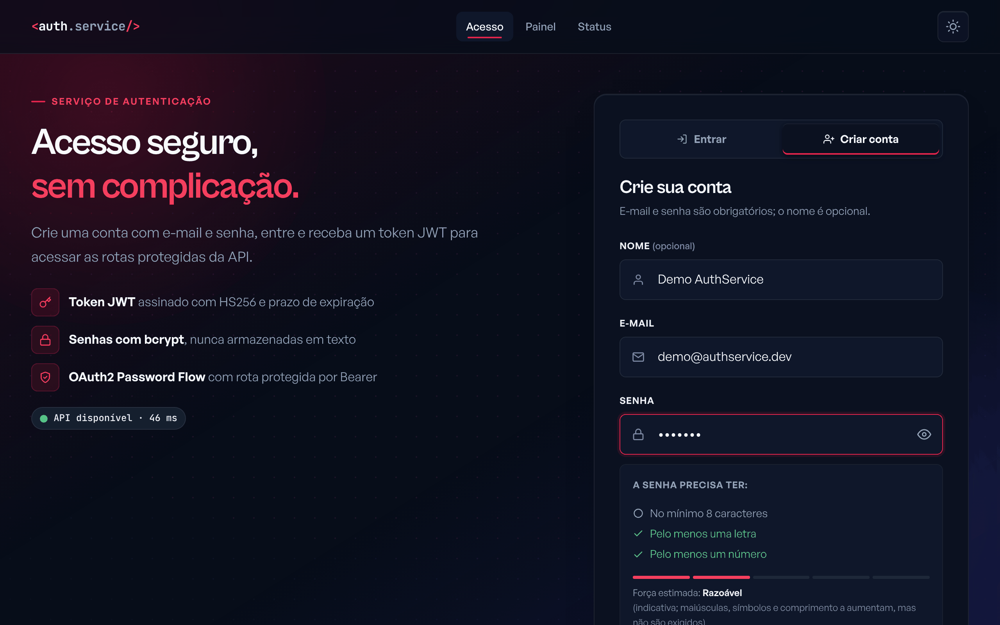
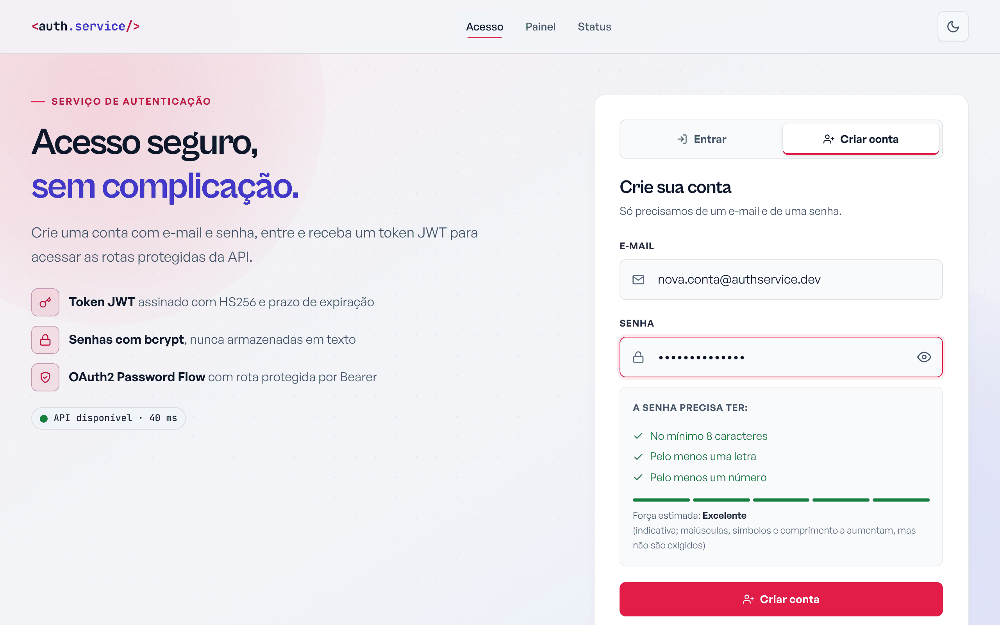
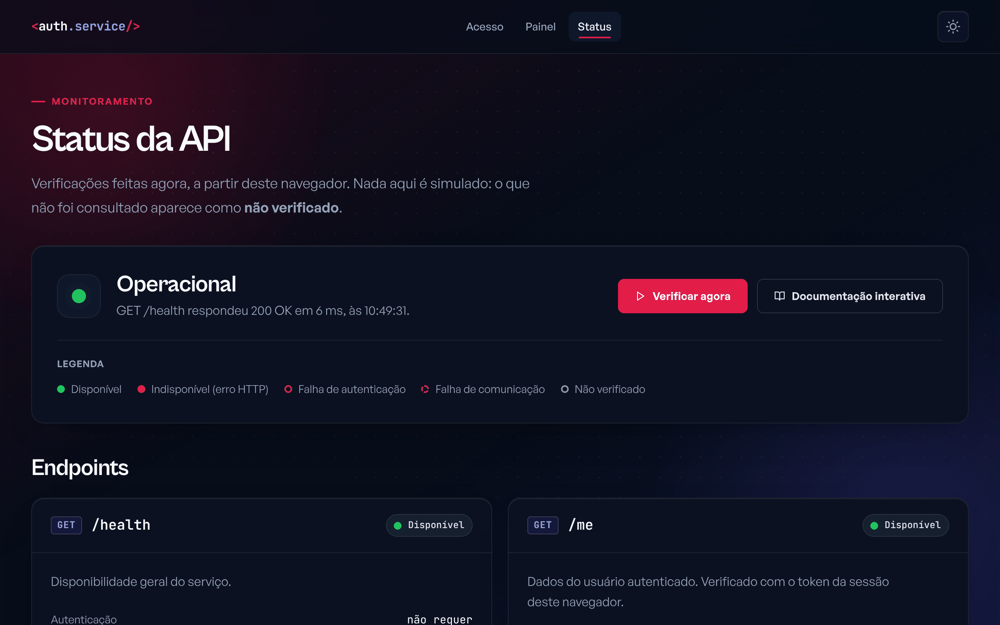

<h1 align="center">🔐 AuthService</h1>

<p align="center">
  Serviço de autenticação fullstack: API REST em <strong>FastAPI</strong> com <strong>JWT</strong> e <strong>bcrypt</strong>,<br/>
  e um frontend próprio servido pelo mesmo processo, em um único container Docker.
</p>

<div align="center">

  [](https://authservice-mbul.onrender.com/docs)
  [](./read-model/LICENSE)
  [](./Dockerfile)
  [](https://fastapi.tiangolo.com)
  [](https://python.org)

</div>

---

<div align="center">
  
</div>

---

## 🌐 Demonstração

<div align="center">

| | |
|---|---|
| 🔗 **Aplicação** | [authservice-mbul.onrender.com](https://authservice-mbul.onrender.com) |
| 📖 **API Docs (Swagger)** | [authservice-mbul.onrender.com/docs](https://authservice-mbul.onrender.com/docs) |
| 📡 **Health check** | [authservice-mbul.onrender.com/health](https://authservice-mbul.onrender.com/health) |
| ⚠️ **Aviso** | Hospedado no plano gratuito do Render: a primeira requisição pode levar até **50 segundos** (cold start), e os usuários cadastrados somem a cada reinício (armazenamento em memória). |

</div>

---

## 📌 O que é

O **AuthService** é um serviço de autenticação de escopo enxuto, pensado para estudo e portfólio. O backend registra usuários, autentica credenciais com **rate limiting**, emite tokens **JWT** de curta duração com **sessões renováveis e revogáveis** e protege rotas com o esquema **Bearer**. O frontend, servido pelo próprio FastAPI como arquivos estáticos, oferece:

- **Acesso** — entrar e criar conta;
- **Painel** — dados da conta autenticada e estado da sessão;
- **Status** — verificações reais dos endpoints, feitas a partir do navegador.

A identidade visual é a mesma do portfólio do autor, [gcruz.dev.br](https://gcruz.dev.br): crimson e índigo sobre neutros slate, tipografia Cabinet Grotesk, General Sans e JetBrains Mono, e o logo tipográfico `<auth.service/>` na mesma construção de `<gcruz.dev/>`.

---

## ✨ Funcionalidades

**API**
- Cadastro (`201 Created`) com e-mail normalizado para minúsculas, nome opcional e senha validada (mínimo de 8 caracteres, ao menos uma letra e um número, no máximo 72 bytes).
- Login pelo fluxo OAuth2 Password (`application/x-www-form-urlencoded`). Devolve um **access token JWT curto** (Bearer) e abre uma **sessão** com refresh token rotativo em cookie `HttpOnly`.
- `POST /refresh` renova o access token (cookie de refresh + header `X-CSRF-Token`); `POST /logout` **revoga a sessão no servidor**.
- **Rate limiting** no login: por IP, por IP + conta e por conta, com `429` e `Retry-After`.
- Rota protegida `GET /me` (`Authorization: Bearer <token>`), com `id`, `email` e `name`.
- **Headers de segurança** em todas as respostas (CSP, `X-Frame-Options`, `nosniff`, `Referrer-Policy`, HSTS opcional).
- Inicialização recusada sem uma `SECRET_KEY` segura.
- `GET /health` e documentação automática em `/docs`, `/redoc` e `/openapi.json`.

**Frontend**
- Abas acessíveis **Entrar / Criar conta** (teclado: setas, Home, End; link direto para `#cadastro`), com campo de nome opcional.
- Validação no cliente que espelha as regras do servidor, com mensagens por campo, checklist da senha e medidor de força apenas indicativo.
- Mostrar/ocultar senha, botões com estado de carregamento, bloqueio de envio duplicado e, após `429`, botão pausado com contagem regressiva.
- Painel com nome, e-mail e ID vindos de `/me`; expiração e algoritmo lidos do token; **renovação automática** quando o access token vence.
- Tratamento de sessão: token vencido ou recusado é renovado uma vez; se a renovação falhar, os dados locais são removidos e aparece "sessão expirada/inválida".
- "Encerrar sessão" revoga a sessão no servidor (access e refresh) e limpa o navegador.
- Token JWT **oculto por padrão** no painel, com ações explícitas de mostrar e copiar.
- Página de status com cinco estados (disponível, indisponível, falha de autenticação, falha de comunicação, não verificado), tempo de resposta medido e histórico da visita.
- Temas escuro e claro sem flash, layout responsivo (360 px a desktop), navegação por teclado, foco visível, `prefers-reduced-motion` e mensagens anunciadas a leitores de tela.

---

## 🖼️ Telas

<div align="center">
  
  <br/><sub>Acesso — entrar</sub>
</div>

<br/>

| Login preenchido | Criar conta |
|---|---|
|  |  |

| Cadastro (tema claro) | Painel |
|---|---|
|  |  |

| Sem sessão | Status da API |
|---|---|
|  |  |

---

## 🛠️ Tecnologias

**Backend** — FastAPI · Uvicorn · Pydantic v2 (com `email-validator`) · pydantic-settings · python-jose (JWT) · bcrypt 4.0.1 · python-multipart · python-dotenv. Rate limiting, sessões e headers são implementados no próprio projeto, sem dependência nova. Apenas o `bcrypt` tem versão fixada em `requirements.txt`.

**Testes** — pytest + `TestClient` do FastAPI (`requirements-dev.txt`).

**Frontend** — HTML, CSS e JavaScript nativos, sem framework e sem etapa de build. Módulos ES, ícones SVG próprios (`frontend/public/icons.svg`), fontes Cabinet Grotesk e General Sans (Fontshare) e JetBrains Mono (Google Fonts).

**Infraestrutura** — Docker (`python:3.11-slim`) e Docker Compose, com healthcheck em `/health`. Deploy no Render. Análise de segurança com CodeQL no GitHub Actions.

---

## 🧱 Arquitetura

```
Navegador ── HTML/CSS/JS estáticos ──┐
   │                                 │  servidos pelo mesmo processo
   └── fetch (mesma origem, cookies) ──► FastAPI (backend/main.py)
                                   ├── middleware de headers de segurança
                                   ├── api/auth_routes.py             rotas HTTP
                                   ├── services/auth_service.py       cadastro e login
                                   ├── services/token_service.py      sessões, refresh, revogação
                                   ├── repositories/user_repository.py  usuários em memória
                                   ├── models/ · schemas/
                                   ├── dependencies/dependencies.py   singletons, get_current_user
                                   └── core/  config · security · email · rate_limit
                                              network · cookies · security_headers · logger
```

As rotas da API são registradas antes de o diretório `frontend/` ser montado na raiz, então `/health`, `/register`, `/token`, `/refresh`, `/logout`, `/me` e `/docs` têm prioridade sobre os arquivos estáticos.

Detalhes em [read-model/MODEL.md](./read-model/MODEL.md) (modelo, regras e fluxos) e [read-model/STRUCTURE.md](./read-model/STRUCTURE.md) (estrutura e setup).

---

## 🗂️ Estrutura

```
AuthService/
├── backend/                 API FastAPI (api → services → repositories → models; core/ transversal)
├── frontend/
│   ├── index.html           acesso (entrar / criar conta)
│   ├── home.html            painel da conta
│   ├── status.html          status da API
│   ├── css/                 tokens, base, layout, components + um arquivo por página
│   ├── js/
│   │   ├── theme-init.js    aplica o tema antes da pintura
│   │   ├── core/            api, auth, session, dom, theme, nav (compartilhados)
│   │   └── pages/           auth, dashboard, status (um por página)
│   └── public/              favicon.svg e sprite de ícones icons.svg
├── tests/                   testes automatizados do backend (pytest)
├── read-model/              MODEL.md, STRUCTURE.md, CONTRIBUTING.md, LICENSE, img/
├── .github/workflows/       codeql.yml
├── Dockerfile · docker-compose.yml · .env.example
├── requirements.txt · requirements-dev.txt · pytest.ini
└── README.md
```

Árvore completa e responsabilidades de cada arquivo em [read-model/STRUCTURE.md](./read-model/STRUCTURE.md).

---

## ⚙️ Configuração

As variáveis são lidas do ambiente ou de um arquivo `.env` na raiz por `backend/core/config.py`. Valores inválidos impedem a inicialização com uma mensagem que diz o que corrigir (sem imprimir segredos).

| Variável | Padrão | Descrição |
|---|---|---|
| `SECRET_KEY` | — (**obrigatória**) | Chave que assina os JWT. Mínimo de 32 caracteres; recusada se vazia, curta, com cara de exemplo ou já publicada no repositório. |
| `ALGORITHM` | `HS256` | `HS256`, `HS384` ou `HS512`. |
| `ACCESS_TOKEN_EXPIRE_MINUTES` | `15` | Validade do access token. |
| `REFRESH_TOKEN_EXPIRE_MINUTES` | `480` | Duração máxima da sessão, contada a partir do login (não é estendida pelas renovações). |
| `REFRESH_REUSE_GRACE_SECONDS` | `10` | Tolerância para duas abas renovando juntas antes de tratar reuso como roubo. |
| `COOKIE_SECURE` | `true` | Cookies com `Secure` e prefixo `__Host-`. Navegadores aceitam em `http://localhost`; use `false` só para testar por HTTP em outro endereço. |
| `LOGIN_IP_MAX_ATTEMPTS` / `LOGIN_IP_WINDOW_SECONDS` | `20` / `60` | Tentativas de login por IP na janela. |
| `LOGIN_ACCOUNT_IP_MAX_FAILURES` | `5` | Falhas por IP + conta antes do bloqueio. |
| `LOGIN_ACCOUNT_MAX_FAILURES` | `20` | Falhas por conta (qualquer IP) antes do bloqueio. |
| `LOGIN_FAILURE_WINDOW_SECONDS` / `LOGIN_LOCKOUT_SECONDS` | `900` / `900` | Janela de contagem das falhas e duração do bloqueio. |
| `TRUSTED_PROXY_HOPS` | `0` | Proxies reversos confiáveis. `0` ignora `X-Forwarded-For` (não falsificável). **No Render, `1`.** |
| `HSTS_ENABLED` / `HSTS_MAX_AGE` | `false` / `31536000` | Envia `Strict-Transport-Security` em requisições HTTPS. Ligue só com HTTPS configurado. |

Gere a chave e coloque-a no `.env` (ou na variável de ambiente do serviço):

```bash
python -c "import secrets; print(secrets.token_urlsafe(48))"
```

> ⚠️ **Troca de chave.** Versões anteriores do `.env.example` traziam uma `SECRET_KEY` pública, e um `.env` com outra chave chegou a ser commitado no histórico. As duas são recusadas na inicialização (a verificação compara hashes; os valores não estão no código). Ambientes que ainda usem alguma delas **não sobem** até receberem uma chave nova. Trocar a chave invalida tokens emitidos com a antiga; como usuários e sessões ficam em memória, eles já não sobreviviam a um reinício.

---

## 🚀 Como rodar

### Com Docker (recomendado)

Requisitos: Docker 24+ e Docker Compose v2.

```bash
git clone https://github.com/https-shini/AuthService.git
cd AuthService
cp .env.example .env        # preencha SECRET_KEY com uma chave gerada
docker compose up --build -d
```

| Ação | Comando |
|---|---|
| Ver logs | `docker logs auth-service-v2 -f` |
| Estado e healthcheck | `docker ps` |
| Parar | `docker compose down` |

O `docker-compose.yml` exige o arquivo `.env` (`env_file`).

### Sem Docker

Requisitos: Python 3.11+.

```bash
git clone https://github.com/https-shini/AuthService.git
cd AuthService
python -m venv venv
source venv/bin/activate     # Windows: venv\Scripts\activate
pip install -r requirements.txt
cp .env.example .env         # preencha SECRET_KEY com uma chave gerada
uvicorn backend.main:app --host 0.0.0.0 --port 8000 --reload
```

Depois de subir, por qualquer um dos caminhos:

```
Frontend:   http://localhost:8000
Swagger:    http://localhost:8000/docs
Health:     http://localhost:8000/health
```

### Testes

```bash
pip install -r requirements-dev.txt
pytest
```

Os testes geram a própria `SECRET_KEY` e não precisam de `.env`.

---

## 📡 Endpoints

| Método | Rota | Entrada | Sucesso | Erros |
|---|---|---|---|---|
| `GET` | `/health` | — | `200` `{ "status": "ok", "message": "…" }` | — |
| `POST` | `/register` | JSON `{ "email", "password", "name"? }` | `201` `{ "id", "email", "name" }` | `400` e-mail já registrado · `422` validação |
| `POST` | `/token` | form `username` (e-mail), `password` | `200` `{ "access_token", "token_type": "bearer" }` + cookies de sessão | `401` credenciais incorretas · `422` campo ausente · `429` muitas tentativas (`Retry-After`) |
| `POST` | `/refresh` | cookie de refresh + header `X-CSRF-Token` | `200` `{ "access_token", "token_type" }` + cookies novos | `401` sessão inválida, expirada, revogada ou refresh reutilizado · `403` CSRF inválido |
| `POST` | `/logout` | `Authorization: Bearer <token>` **ou** cookie de refresh + `X-CSRF-Token` | `204` (cookies apagados) | `403` só cookie, sem CSRF válido |
| `GET` | `/me` | `Authorization: Bearer <token>` | `200` `{ "id", "email", "name" }` | `401` token ausente, inválido, expirado ou revogado |

Os erros seguem o formato do FastAPI: `{ "detail": "mensagem" }` ou, em `422`, `{ "detail": [ { "loc", "msg", "type" } ] }`. Os `401` de token usam sempre a mesma mensagem genérica e nunca ecoam o token.

> **Mudanças de contrato desta versão:** `/register` passou de `200` para **`201`** e ganhou `name` (opcional) na entrada e na saída; `/me` também devolve `name`; e-mails passam a ser comparados sem diferenciar maiúsculas; `/token` pode responder `429`; tokens emitidos por versões anteriores (sem `jti`/`sid`) não são mais aceitos. Clientes que comparavam o status do cadastro com `200` precisam aceitar `201`.

### Exemplos com cURL

```bash
curl -X POST http://localhost:8000/register \
  -H "Content-Type: application/json" \
  -d '{"email": "usuario@email.com", "password": "Senha123", "name": "Usuário"}'
```

```bash
curl -c cookies.txt -X POST http://localhost:8000/token \
  -d "username=usuario@email.com&password=Senha123"
```

```bash
curl http://localhost:8000/me \
  -H "Authorization: Bearer SEU_TOKEN_AQUI"
```

Renovar e encerrar a sessão usando os cookies salvos (testado com curl 8.5, que envia cookies `Secure` para `localhost`):

```bash
CSRF=$(awk '$6 ~ /auth_csrf$/ {print $7}' cookies.txt)
```

```bash
curl -b cookies.txt -c cookies.txt -X POST http://localhost:8000/refresh -H "X-CSRF-Token: $CSRF"
```

```bash
curl -X POST http://localhost:8000/logout -H "Authorization: Bearer SEU_TOKEN_AQUI"
```

---

## 🔑 Autenticação e política de tokens

1. `POST /register` normaliza o e-mail, valida a senha, gera o hash com **bcrypt** e guarda o usuário em memória.
2. `POST /token` passa pelo rate limiting, confere e-mail e senha (com custo de bcrypt igual para e-mail inexistente) e abre uma **sessão**:
   - **access token** JWT no corpo, com `sub`, `sid` (sessão), `jti` (único), `type`, `iat` e `exp`;
   - **refresh token** aleatório em cookie `HttpOnly` (o JavaScript não lê);
   - **token CSRF** em cookie legível, que o frontend devolve no header `X-CSRF-Token`.
3. Rotas protegidas recebem `Authorization: Bearer <token>`. O token precisa ter assinatura e prazo válidos, não ter sido revogado e pertencer a uma sessão ativa.
4. Quando o access token vence, o frontend chama `POST /refresh`. O refresh token é **rotacionado** a cada uso; reapresentar um já trocado fora da tolerância revoga a sessão inteira (indica cópia). Renovações são serializadas entre abas.
5. `POST /logout` revoga o access token apresentado e a sessão (todos os access tokens dela e o refresh). O frontend apaga o token local mesmo se o servidor não responder, e avisa nesse caso.

| Item | Política |
|---|---|
| Access token | JWT `HS256`, 15 min (configurável), Bearer, guardado no `sessionStorage` da aba |
| Refresh token | Opaco, 256 bits, cookie `__Host-auth_refresh; HttpOnly; Secure; SameSite=Strict; Path=/`, sem `Max-Age` (some ao fechar o navegador) |
| Sessão | Prazo absoluto de 8 h a partir do login; renovações não estendem |
| CSRF | Token por sessão, conferido no servidor (não basta repetir o cookie); renovado a cada refresh |
| Armazenamento | Só hashes SHA-256 de refresh e CSRF; tudo em memória |
| Revogação | Por `jti` (até o `exp`) e por sessão (`sid`) |

**Por que o access token não foi para cookie:** a API continua compatível com clientes Bearer (Swagger, cURL, outros serviços). Colocar o access token em cookie exigiria CSRF em todas as rotas e dois modos de autenticação. O refresh token, que é o segredo de longa duração, ficou fora do alcance do JavaScript; o access token é curto e revogável.

Autorização: existe apenas a distinção entre autenticado e não autenticado. Não há papéis ou permissões.

---

## 🚦 Rate limiting

Aplicado ao `POST /token`, em memória, com janelas deslizantes:

| Contador | Limite padrão | Efeito |
|---|---|---|
| IP | 20 tentativas por minuto | `429` até a janela liberar |
| IP + conta | 5 falhas em 15 min | bloqueio de 15 min para aquele IP naquela conta |
| Conta (qualquer IP) | 20 falhas em 15 min | bloqueio de 15 min da conta (contra ataques distribuídos) |

- A conta é o e-mail normalizado: trocar maiúsculas não cria um contador novo.
- Durante o bloqueio a senha não é verificada, nem a correta (sem oráculo).
- Login certo zera as falhas daquele IP para a conta, mas não o contador global da conta.
- O IP vem da conexão. `X-Forwarded-For` só é usado com `TRUSTED_PROXY_HOPS > 0`, e então vale o item acrescentado pelo proxy, não o que o cliente escreveu.
- Senhas e tokens não aparecem nos logs.

---

## 🛡️ Headers e segurança

**Servidor (todas as respostas):** `X-Content-Type-Options: nosniff`, `X-Frame-Options: DENY`, `Referrer-Policy: strict-origin-when-cross-origin`, `Permissions-Policy` restritiva, `Cross-Origin-Opener-Policy` e `Cross-Origin-Resource-Policy: same-origin`. Rotas de autenticação recebem `Cache-Control: no-store`.

**Content-Security-Policy:**
- páginas do frontend: a **mesma** política do `<meta>` dos HTML + `frame-ancestors 'none'` (um teste garante que não divirjam);
- `/docs` e `/redoc`: só `frame-ancestors 'none'` (o Swagger usa CDN e scripts inline);
- JSON e arquivos estáticos: `default-src 'none'`.

**HSTS:** só com `HSTS_ENABLED=true` e em requisição HTTPS (inclusive atrás de proxy confiável via `X-Forwarded-Proto`).

**Frontend:** nenhuma senha em storage, cookies ou logs; nenhum dado externo via `innerHTML`; nenhum script inline; token oculto por padrão e nunca em URLs.

---

## ⚠️ Limitações conhecidas

- **Estado em memória**: usuários, sessões e contadores de rate limit somem quando o processo reinicia e não são compartilhados entre réplicas. Rode **uma única instância**.
- **Access token no `sessionStorage`**: um XSS conseguiria lê-lo. A CSP sem scripts inline e a montagem segura do DOM reduzem esse risco, e o token é curto e revogável; o refresh token fica em `HttpOnly`.
- **Bloqueio por conta**: alguém que erre a senha de propósito 20 vezes em 15 min bloqueia o login daquela conta por 15 min.
- **Duplicatas antigas**: contas criadas antes da normalização que só diferem em maiúsculas continuam entrando com a forma exata; uma variação só é aceita se não for ambígua.
- **Sem recuperação de senha, MFA ou papéis.**
- `requirements.txt` sem versões fixadas (exceto `bcrypt`).

---

## 🗺️ Pendências / Roadmap

Itens planejados — **nenhum deles está implementado**.

| Prioridade | Item | Descrição |
|---|---|---|
| Alta | Persistência | Banco de dados (PostgreSQL + SQLAlchemy + Alembic, ou SQLite como passo intermediário) para usuários e sessões. |
| Alta | Estado compartilhado | Mover sessões e rate limiting para um armazenamento comum (por exemplo, Redis) para permitir mais de uma instância. |
| Média | Access token só em memória | Tirar o access token do `sessionStorage` e obtê-lo via `/refresh` a cada carregamento de página. |
| Média | MFA / TOTP | Segundo fator com aplicativo autenticador. |
| Média | RBAC | Papéis como claim no JWT e autorização por rota. |
| Média | CI de testes | Rodar `pytest` no GitHub Actions a cada push e pull request. |
| Baixa | Recuperação de senha | Reset por e-mail com token temporário de uso único (requer SMTP). |
| Baixa | Logs estruturados | Logs em JSON com níveis e correlation IDs. |
| Baixa | Segredos fora do `.env` | `SECRET_KEY` em gerenciador de segredos em produção. |
| Baixa | Fixar dependências | Versões travadas em `requirements.txt`. |

---

## 🤝 Como contribuir

O passo a passo está em [read-model/CONTRIBUTING.md](./read-model/CONTRIBUTING.md) (PT-BR e EN-US). Commits seguem Conventional Commits:

```bash
git checkout -b minha-feature
git commit -m "feat: minha nova feature"
git push origin minha-feature
```

---

## 📚 Documentação adicional

| Arquivo | Conteúdo |
|---|---|
| [read-model/MODEL.md](./read-model/MODEL.md) | Entidades, regras de negócio, fluxos e decisões arquiteturais |
| [read-model/STRUCTURE.md](./read-model/STRUCTURE.md) | Estrutura de diretórios, responsabilidades e setup |
| [read-model/CONTRIBUTING.md](./read-model/CONTRIBUTING.md) | Guia de contribuição |

---

## 📄 Licença

Distribuído sob a licença **MIT**. Veja [read-model/LICENSE](./read-model/LICENSE).

---

<div align="center">

Um projeto [`<gcruz.dev/>`](https://gcruz.dev.br) — autenticação simples, segura e com a mesma identidade do portfólio.

</div>


